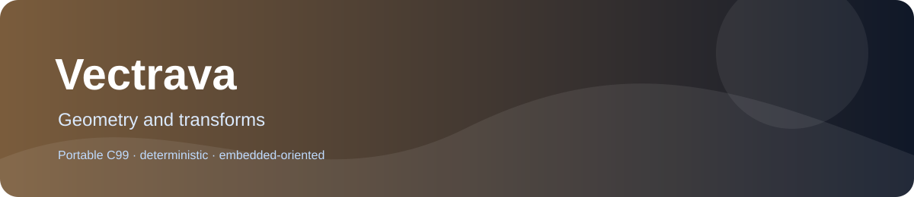

# Vectrava
  



Vectors, ranges, transforms, quaternions, bounding volumes and spatial calculations.

## Why it exists

Embedded robotics and motion code needs fixed-point geometry with explicit bounds and no heap.

## What is included

- Portable C99-oriented implementation.
- Deterministic integer or fixed-point behavior documented at function level.
- No mandatory heap, threads or operating-system services.
- Separate translation units for selective linking.

## Quick start

```sh
cmake -S . -B build -DVECTRAVA_BUILD_TESTS=ON
cmake --build build --parallel
ctest --test-dir build --output-on-failure
```

For a minimal integration, include only the required public header and compile the matching source unit.

For selective integration, include the header for the operation you need and compile its corresponding source unit, or link the static CMake target.

## Documentation

| Need | Read |
|---|---|
| Choose a primitive | [Family guide](docs/FAMILY_GUIDE.md) |
| Check every function and contract | [API reference](docs/API_REFERENCE.md) |
| Reproduce tests and see validation limits | [Testing report](docs/TESTING.md) |
| Review design and dependencies | [Architecture](docs/ARCHITECTURE.md) |
| See measured or pending performance data | [Performance](docs/PERFORMANCE.md) |

## At a glance

The public surface consists of 54 headers: 52 callable functions and two shared matrix type definitions under `include/`. Implementations are in `src/` and tests are in `tests/`.

The CMake test option is VECTRAVA_BUILD_TESTS. The library has no mandatory third-party dependency. Platform-specific link requirements are documented in CMake and the affected API header.

## Validation status

**Audit verdict: READY FOR PUBLIC RELEASE.**

GCC strict: 36/36; Clang-cl strict: 33/33; MSVC Debug and Release: 33/33 each; ASan and UBSan: 33/33 each under Clang 22. Representative ESP32-S3 correctness tests passed; the full 52-function hardware suite was not run. See [audit register](docs/AUDIT.md) and [test evidence](docs/TESTING.md).

Detailed overflow, rounding, invalid-input, memory-ownership and state rules are defined by the public headers and API reference. Do not infer them from the product name alone.

## License

Apache License 2.0, copyright Vanderhell. See [LICENSE](LICENSE) and [NOTICE](NOTICE).
